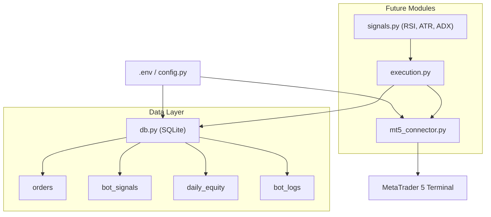

# 02 - Architecture Map

## Layer Definitions
1. **Config Layer**: Single-point configuration loader (`config.py`).
2. **Storage Layer**: SQLite (`db.py`) handling trade journals, signal history, equity logs, system diagnostics.
3. **Broker Interface**: MT5 Python API bridge (`mt5_connector.py`).
