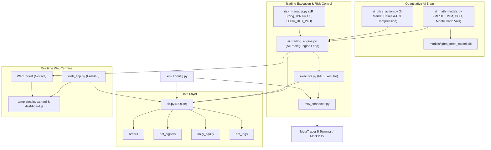

# 02 - Architecture Map

## Layer Definitions
1. **Config Layer**: Single-point configuration loader (`config.py`).
2. **Storage Layer**: SQLite (`db.py`) handling trade journals, signals with Market Case/Regime tags, daily equity, and system logs.
3. **Broker Interface**: MT5 Python API bridge (`mt5_connector.py`) with cross-platform MockMT5 support.
4. **Quantitative AI Brain**: 6 Market Cases Price Action (`ai_price_action.py`), Vectorized ML/DL, Gaussian HMM Regimes, and Isolation Forest OOD filter (`ai_math_models.py`).
5. **Risk & Execution Layer**: 1R position sizing, $R:R \ge 1.5$ guard, 24h circuit breaker (`risk_manager.py`), MT5 order execution (`executor.py`), and master orchestrator (`ai_trading_engine.py`).
6. **Realtime Web Terminal**: FastAPI backend with WebSocket streaming `/ws/live` pushing live ticks, dynamic candle updates, AI HUD metrics, and live VNĐ wallet directly to the browser (`dashboard.js`, `lightweight-charts.js`).
