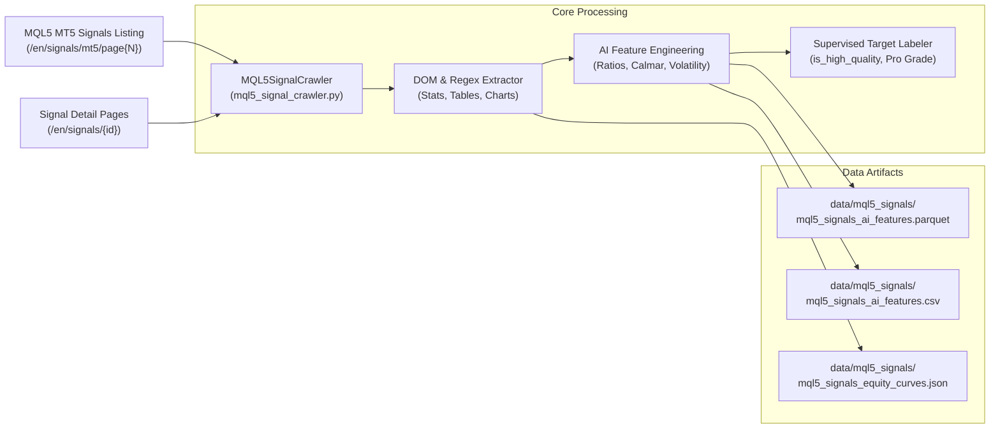

# SA: MQL5 MT5 Signals Crawler & AI Training Dataset Pipeline

## 1. Mục tiêu (Objective)
Tạo phân hệ thu thập (crawler) dữ liệu định lượng chuyên sâu từ cộng đồng giao dịch MetaTrader 5 thực chiến tại [MQL5 Signals MT5](https://www.mql5.com/en/signals/mt5). Phục vụ huấn luyện mô hình AI học máy giám sát (Supervised Learning), mô hình chấm điểm tín hiệu (Strategy Scoring), và phân loại rủi ro (Risk Regime Classification) cho bot giao dịch định lượng.

## 2. Kiến trúc Hệ thống (System Architecture)


## 3. Danh mục Đặc trưng AI (AI Feature Matrix - 69 thuộc tính)
- **Thông tin cơ sở**: `signal_id`, `title`, `author`, `rating`, `reviews_count`, `growth_pct`, `algo_trading_pct`, `subscribers`, `price_usd`, `weeks`, `broker_server`, `leverage_ratio`.
- **Hiệu suất & Lợi nhuận**: `profit_usd`, `equity_usd`, `balance_usd`, `trades_count`, `profit_trades_count`, `profit_trades_pct`, `loss_trades_count`, `loss_trades_pct`, `best_trade_usd`, `worst_trade_usd`, `gross_profit_usd`, `gross_loss_usd`.
- **Định lượng Rủi ro & Ổn định**:
  - `sharpe_ratio`: Hệ số Sharpe đo lường tỷ suất sinh lời trên biến động rủi ro.
  - `recovery_factor`: Khả năng hồi phục tài khoản sau sụt giảm.
  - `profit_factor`: Tổng lãi gộp / Tổng lỗ gộp.
  - `drawdown_maximal_usd` & `drawdown_maximal_pct`: Độ sụt giảm tối đa (Max Drawdown).
  - `drawdown_rel_balance_pct` & `drawdown_rel_equity_pct`: Sụt giảm tương đối theo Equity và Balance.
  - `max_deposit_load_pct`: Tải tiền gửi lớn nhất (Margin load).
- **Đặc trưng phái sinh (Feature Engineering)**:
  - `payoff_ratio`: $|Average Profit / Average Loss|$.
  - `win_loss_ratio`: Số lệnh thắng / Số lệnh thua.
  - `calmar_ratio`: Dự báo lợi nhuận năm / Max Drawdown.
  - `market_exposure_ratio`: Mức độ phơi nhiễm thị trường thời gian thực.
  - `consecutive_resilience`: Tỷ số chuỗi thắng tối đa / chuỗi thua tối đa.
- **Nhãn mục tiêu (Supervised Target Labels)**:
  - `is_high_quality` (Binary 0/1): Đạt chuẩn Pro Strategy ($PF \ge 1.4$, $MaxDD \le 25\%$, $WinRate \ge 52\%$, $Trades \ge 10$).
  - `is_profitable` (Binary 0/1): Tín hiệu có lợi nhuận dương.
  - `quality_grade` (Multi-class 0, 1, 2): 0 (Nguy cơ sụt giảm cao), 1 (Trung bình), 2 (Elite Pro Signal).
  - `target_profit_factor` (Regression): Giá trị Profit Factor thực tế.

## 4. Hướng dẫn Sử dụng (CLI & Python API)
```bash
# Kiểm tra nhanh 1 trang:
.venv/bin/python mql5_signal_crawler.py --test

# Crawl đầy đủ 3 trang với 6 luồng xử lý:
.venv/bin/python mql5_signal_crawler.py --pages 3 --workers 6

# Chạy Unit Tests xác thực parser:
.venv/bin/python test_mql5_signal_crawler.py
```

